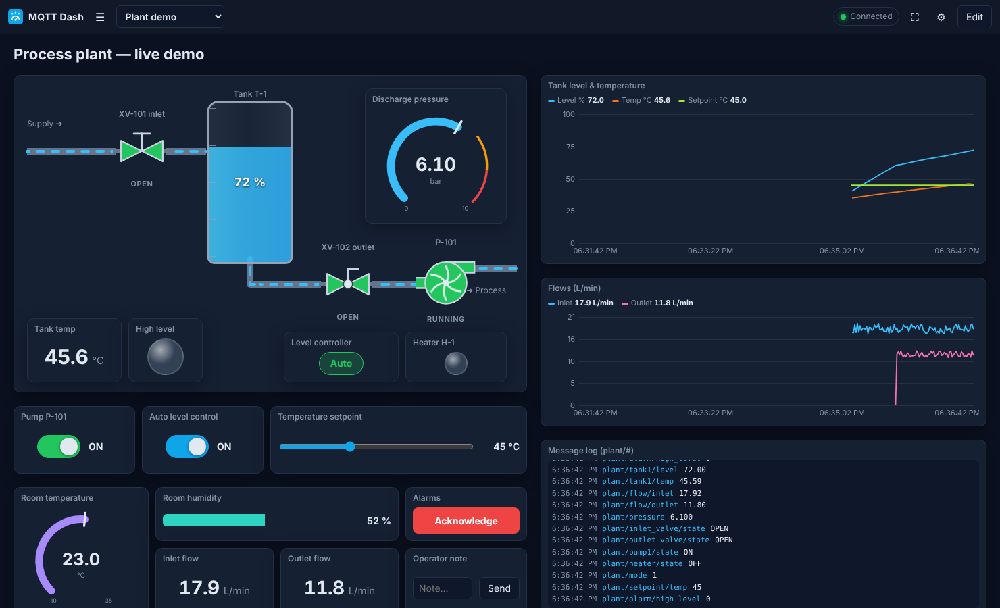

# riotdash

**Riot MQTT Broker.** A self-hosted MQTT broker with a drag-and-drop dashboard, in one small service for Linux. The app itself is called *MQTT Dash*.

- **Broker:** MQTT 3.1.1 on TCP `:1883`, and MQTT over WebSockets at `/mqtt` on the web port. Supports retained messages, last will, `+`/`#` wildcards, optional username/password and per-user publish limits.
- **Dashboards:**
  - Drag and drop widgets: gauges, trends, tanks, valves, pumps, animated pipes, switches, sliders, lamps, logs and more.
  - Bind data by dragging a topic onto a widget.
  - Phones get a list layout, and tablets get *Fit to width*.
- **Explorer:** a live topic tree, a payload viewer with history charts, a publish box, and a list of connected clients.
- **Updates in the app:** upload a new package and it installs, restarts and keeps a rollback copy. Your settings and data are never touched.
- **No dependencies:** plain Node.js 18 or newer. No `npm install`.
- **Cloudflare-ready:** the UI, API and MQTT-over-WSS all go through one port, so a single Cloudflare Tunnel publishes everything.



## Quick start

```bash
git clone https://github.com/homershaw/riotdash.git
cd riotdash
node server/index.js          # broker + dashboard → http://localhost:8080
node tools/simulator.js       # optional: demo plant data (second terminal)
```

## Documentation

| Guide | What's in it |
|---|---|
| [Getting started](docs/getting-started.md) | Install, run, change ports, reach it from other devices, firewall, run as a service |
| [Dashboards](docs/dashboards.md) | Editor, widgets, binding topics, JSON paths, phone/tablet layouts |
| [Explorer](docs/explorer.md) | Browsing topics, history, publishing, clients |
| [Configuration](docs/configuration.md) | `config.json` reference, broker users and passwords |
| [Updating](docs/updating.md) | In-app updates, admin password, rollback, building a release |
| [Cloudflare](docs/cloudflare.md) | Publishing the dashboard and MQTT through a Cloudflare Tunnel |
| [Changelog](CHANGELOG.md) | What changed in each version |

## Project layout

```
server/   index.js (supervisor, HTTP, API) · updater.js · broker.js · codec.js · websocket.js · store.js · demo-dashboard.js
public/   index.html · explorer.html · css/ · js/app.js (editor) · js/widgets.js · js/explorer.js · js/update.js · js/mqtt.js
tools/    simulator.js · selftest.js · release.sh
deploy/   install.sh · systemd units · desktop launcher · cloudflare/config.yml
docs/     guides
```

Run the tests with `node tools/selftest.js`.
