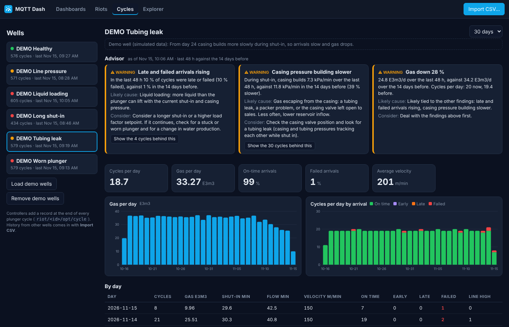

# Plunger cycles


Every plunger cycle becomes one record: when the valve closed and opened, when (and whether) the plunger arrived, the pressures, the gas produced and the setpoints in effect. riotdash keeps the records per well in `data/cycles/<well>.jsonl`. They are the base for the cycle history now, and for the Advisor and AI tuning that come next.

The **Cycles** page shows, per well, for 7 days to a year ending today, at the well's last cycle (for imported history), or on an **ending** date you pick:
- cycles per day, gas per day, on-time and failed arrival rates, average velocity
- gas per day, and cycles per day split by arrival result (hover a day for its numbers)
- a table by day and the most recent cycles

## Advisor



The Advisor runs plain checks on each well's cycles: the last 48 hours (or the last 10 cycles, for a well that cycles only a few times a day) against the 14 days before (at least 30 cycles), as of the well's newest record (so imported history is judged as of its own last day). It only reports; it never changes a setpoint. With an ending date picked, it judges the well as of that date. Each finding gives the numbers it saw, the likely cause, what to consider, and a button that highlights the cycles behind it. The dot beside each well in the list shows its worst finding.

| Finding | When | Likely cause |
|---|---|---|
| No cycles recorded | no cycle for 2.5 times the well's usual spacing (at least 6 h) | optimizer stopped, ESD, valve or communication problem |
| Casing pressure building slower | casing build rate during shut-in down 30 % or more (shut-ins under 4 h) | tubing or packer leak, casing valve open to sales |
| Casing not building as high | casing at open down 10 % and 150 kPa at a similar shut-in (shut-ins over 4 h, where casing levels off) | as above, or lower reservoir pressure |
| Line pressure higher | line pressure at open up 100 kPa and 25 % or more, or 20 %+ of cycles ending on line pressure high | gathering system or compressor, not the well |
| Velocity creeping up | velocity rising over 2.5 %/day for 7 days, with setpoints, shut-in and line pressure steady | worn plunger or pad |
| Plunger arriving too fast / slowly | median velocity more than 25 % off the target (SPT2.12) | shut-in too long / too short, or more liquid |
| Plunger slowing down / arriving faster | no target set: median velocity 25 % lower / 35 % higher than the well's own baseline | more liquid (early loading) / a change at the well or a worn plunger |
| Late and failed arrivals rising | 10 %+ failed (at least 2), or late + failed up 15 points to 25 %+ | liquid loading |
| Cycle timing changed (note) | median shut-in or flow time changed 15 % and 5 min or more, or setpoints changed | a setpoint change; shown with gas before and after so you can judge it |
| Gas down | gas per day 25 % or more below the 14-day baseline | the other findings, or decline or measurement |

The line-pressure and gas thresholds were set by replaying 17 months of two real wells: low-pressure gathering lines swing 20–50 kPa a day, so smaller changes are not flagged.

When a cause and its symptom both show (for example a tubing leak causing weak arrivals), the cause is listed first and the symptom points to it.

### Trying it with demo wells

**Load demo wells** on the Cycles page adds six simulated wells with 30 days of cycles ending now, each with one known problem: *Healthy* (nothing should be flagged), *Worn plunger*, *Liquid loading*, *Tubing leak*, *Line pressure* and *Long shut-in*. Each demo well's page says what was simulated, so you can compare that with what the Advisor found. **Remove demo wells** deletes them; real wells are not touched. Loading them again replaces them with fresh data ending at the current time.

## Where records come from

**Controllers** publish one record when a cycle ends (the valve closes after flowing):

| Topic | Retained |
|---|---|
| `riot/<id>/opt/cycle` | no |
| `riot/<id>/opt/run2/cycle` | no (optimizer run 2) |

Only approved or waiting controllers are recorded. A record sent twice (same run and `seq`) is kept once, so a controller can safely re-send unsent records after a reconnect.

**History from other wells** loads from a CSV, one row per cycle, using the same field names plus `well`:
- on the Cycles page: **Import CSV…**
- or on the server: `node server/index.js import-cycles cycles.csv [well name]`

Rows already imported (same well and open time) are skipped, so importing a file twice is safe. Rows with errors are skipped and listed.

```csv
well,openTs,shutInMin,flowMin,arrival,tripMin,velocity,casingOpen,tubingOpen,lineOpen,gas,mode,SPT1.11,SPT2.12
BRAZEAU 4-12,2026-10-01 06:30,30,50,ontime,9,222,1310,1180,640,2.08,2,30,200
BRAZEAU 4-12,2026-10-01 07:50,30,22,late,16.5,121,1220,1150,655,0.71,2,30,200
```

Required: `well`, `openTs`, `shutInMin` or `closeTs`, `flowMin` or `endTs`. Times are epoch seconds or `YYYY-MM-DD hh:mm` (UTC unless followed by an offset such as `-06:00`). `well` is a controller id (`FED0`) or any name.

## Record fields

Times are epoch seconds (UTC), pressures kPa, gas E3m3, durations minutes, velocity m/min.

| Field | Meaning |
|---|---|
| `v`, `seq`, `run`, `mode` | format (1), cycle counter, optimizer run, mode during the cycle |
| `closeTs`, `openTs`, `arriveTs`, `endTs` | valve closed (shut-in start), opened, plunger arrived (0 = didn't), closed again |
| `arrival` | `ontime`, `early`, `late`, `failed` or `none` (no plunger sensor) |
| `shutInMin`, `tripMin`, `afterflowMin`, `flowMin` | durations; worked out from the times when missing |
| `velocity` | well depth / trip time; worked out from `sp` SPT0.9 when missing |
| `casingOpen`, `tubingOpen`, `lineOpen`, `loadFactorOpen` | just before the valve opened |
| `casingArrive`, `tubingArrive` | at arrival |
| `casingEnd`, `tubingEnd`, `lineEnd`, `lineMax` | when the valve closed; highest line pressure in the cycle |
| `gas`, `flowAvg` | gas during the flow period; average rate while open (gas is worked out from it when missing) |
| `end`, `error` | why the valve closed: the mode status code at close (e.g. 2012 post plunger sales, 2010 line pressure high), or `stopped`, `esd`, `restart`; program error at close |
| `sp` | the R/W soft points in effect when the valve opened, `{"SPTn.p": value}` |

## Raw history (time, tag, value)

Historian exports with one reading per line, such as `2024-08-07T01:40:03.1,BPCV,100`, are turned into cycle records by `tools/hist-to-cycles.js`:

```
node tools/hist-to-cycles.js well_1/ --well "Well 1" --tz -07:00 --out well1-cycles.csv
node server/index.js import-cycles well1-cycles.csv
```

- A cycle opens when the valve tag (`--valve`, default `BPCV`) goes above 1 % or flow (`--flow`, default `FlowCurrent`) above 0.2, after being shut at least 5 min (`--min-shut`). A throttling valve touching 0 briefly while flowing doesn't end the cycle, and a valve blip under 1 min with no gas (`--min-flow`) isn't a cycle.
- Casing and line come from `--casing` (default `Casing`) and `--line` (default `Line`). Gas is the flow rate, taken as E3m3/d, integrated over the flow period.
- Cycles across a gap in the data longer than 60 min (`--max-gap`) are dropped. Times without an offset are read with `--tz`.
- Raw history has no plunger sensor, so arrivals are `none` and the velocity and arrival checks don't apply.

To see what the Advisor would have said over a well's whole history, day by day:

```
node tools/advisor-replay.js "Well 1" --tz -07:00
node tools/advisor-replay.js --csv well1-cycles.csv
```

## RTU exports: plunger log and current values

Some RTUs export a plunger log (one row per arrival: `Time, Plunger Time (Min), WellDepth, Plunger Velocity (M/mins)`, with -1 for no arrival) and a file of current values (`Time, Casing Press (kPa), Line Press (kPa), Flow Rate, Flow Today, …`). `tools/plunger-log-to-cycles.js` combines the two:

```
node tools/plunger-log-to-cycles.js --plunger plunger.csv --current current.csv --well "08-33-052-21W5M" --tz -07:00 --out cycles.csv
node server/index.js import-cycles cycles.csv
```

- Each arrival is a cycle that opened at arrival − trip time; a -1 row is a failed cycle. Rows that only repeat the previous trip at an odd time are skipped.
- Pressures at open are the last sample before the open. Gas is the rise of Flow Today between one open and the next (a drop is taken as the daily reset).
- `--early` and `--late` (trip minutes) classify arrivals; without them every arrival counts as on time. `--target` (m/min) sets the target velocity so the Advisor can judge fast and slow arrivals; without it the Advisor compares the well with its own recent velocity.

## Storage and size

One line per cycle, about 400 bytes: a well cycling 20 times a day uses about 3 MB a year. Each well's file is read into memory when its page is opened. That comfortably covers hundreds of wells over several years.
