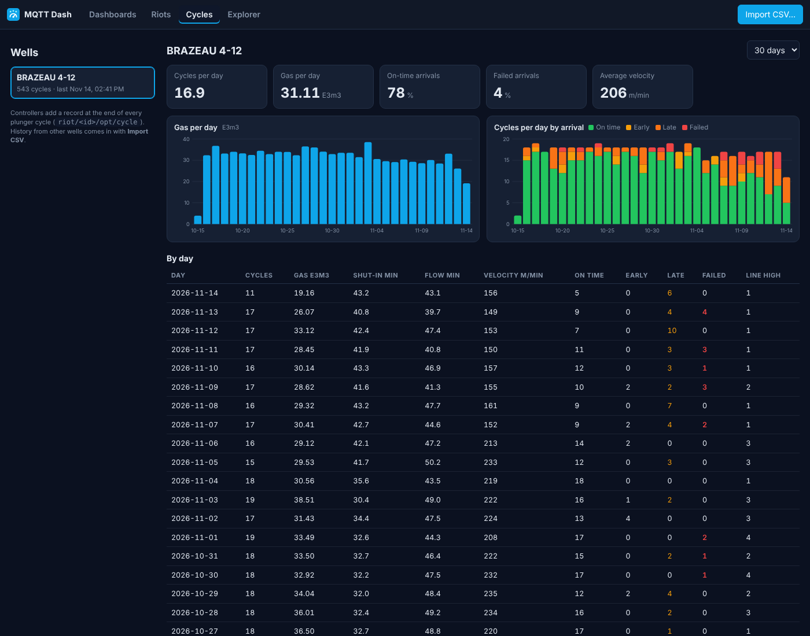

# Plunger cycles



Every plunger cycle becomes one record: when the valve closed and opened, when (and whether) the plunger arrived, the pressures, the gas produced and the setpoints in effect. riotdash keeps the records per well in `data/cycles/<well>.jsonl`. They are the base for the cycle history now, and for the Advisor and AI tuning that come next.

The **Cycles** page shows, per well and for 7 days to a year:
- cycles per day, gas per day, on-time and failed arrival rates, average velocity
- gas per day, and cycles per day split by arrival result (hover a day for its numbers)
- a table by day and the most recent cycles

## Advisor


The Advisor runs plain checks on each well's cycles: the last 48 hours against the 14 days before, as of the well's newest record (so imported history is judged as of its own last day). It only reports; it never changes a setpoint. Each finding gives the numbers it saw, the likely cause, what to consider, and a button that highlights the cycles behind it. The dot beside each well in the list shows its worst finding.

| Finding | When | Likely cause |
|---|---|---|
| No cycles recorded | a reporting well has had no cycle for over 6 h | optimizer stopped, ESD, valve or communication problem |
| Casing pressure building slower | casing build rate during shut-in down 30 % or more | tubing or packer leak, casing valve open to sales |
| Line pressure higher | line pressure at open up 15 % or more, or 20 %+ of cycles ending on line pressure high | gathering system or compressor, not the well |
| Velocity creeping up | velocity rising over 2.5 %/day for 7 days, with setpoints, shut-in and line pressure steady | worn plunger or pad |
| Plunger arriving too fast / slowly | median velocity more than 25 % off the target (SPT2.12) | shut-in too long / too short, or more liquid |
| Late and failed arrivals rising | 10 %+ failed, or late + failed up 15 points to 25 %+ | liquid loading |
| Gas down | gas per day 15 % or more below the 14-day baseline | the other findings, or decline or measurement |

When a cause and its symptom both show (for example a tubing leak causing weak arrivals), the cause is listed first and the symptom points to it.

### Trying it with demo wells

**Load demo wells** on the Cycles page adds six simulated wells with 30 days of cycles ending now, each with one known problem: *Healthy* (nothing should be flagged), *Worn plunger*, *Liquid loading*, *Tubing leak*, *Line pressure* and *Long shut-in*. Each demo well's page says what was simulated, so you can compare that with what the Advisor found. **Remove demo wells** deletes them; real wells are not touched. Loading them again replaces them with fresh data ending at the current time.

## Where records come from

**Controllers** publish one record when a cycle ends (the valve closes after flowing):

| Topic | Retained |
|---|---|
| `riot/<id>/opt/cycle` | no |
| `riot/<id>/opt/run2/cycle` | no (optimizer run 2) |

Only approved or waiting controllers are recorded. A record sent twice (same run and `seq`) is kept once, so a controller can safely re-send unsent records after a reconnect.

**History from other wells** loads from a CSV, one row per cycle, using the same field names plus `well`:
- on the Cycles page: **Import CSV…**
- or on the server: `node server/index.js import-cycles cycles.csv [well name]`

Rows already imported (same well and open time) are skipped, so importing a file twice is safe. Rows with errors are skipped and listed.

```csv
well,openTs,shutInMin,flowMin,arrival,tripMin,velocity,casingOpen,tubingOpen,lineOpen,gas,mode,SPT1.11,SPT2.12
BRAZEAU 4-12,2026-10-01 06:30,30,50,ontime,9,222,1310,1180,640,2.08,2,30,200
BRAZEAU 4-12,2026-10-01 07:50,30,22,late,16.5,121,1220,1150,655,0.71,2,30,200
```

Required: `well`, `openTs`, `shutInMin` or `closeTs`, `flowMin` or `endTs`. Times are epoch seconds or `YYYY-MM-DD hh:mm` (UTC unless followed by an offset such as `-06:00`). `well` is a controller id (`FED0`) or any name.

## Record fields

Times are epoch seconds (UTC), pressures kPa, gas E3m3, durations minutes, velocity m/min.

| Field | Meaning |
|---|---|
| `v`, `seq`, `run`, `mode` | format (1), cycle counter, optimizer run, mode during the cycle |
| `closeTs`, `openTs`, `arriveTs`, `endTs` | valve closed (shut-in start), opened, plunger arrived (0 = didn't), closed again |
| `arrival` | `ontime`, `early`, `late`, `failed` or `none` (no plunger sensor) |
| `shutInMin`, `tripMin`, `afterflowMin`, `flowMin` | durations; worked out from the times when missing |
| `velocity` | well depth / trip time; worked out from `sp` SPT0.9 when missing |
| `casingOpen`, `tubingOpen`, `lineOpen`, `loadFactorOpen` | just before the valve opened |
| `casingArrive`, `tubingArrive` | at arrival |
| `casingEnd`, `tubingEnd`, `lineEnd`, `lineMax` | when the valve closed; highest line pressure in the cycle |
| `gas`, `flowAvg` | gas during the flow period; average rate while open (gas is worked out from it when missing) |
| `end`, `error` | why the valve closed: the mode status code at close (e.g. 2012 post plunger sales, 2010 line pressure high), or `stopped`, `esd`, `restart`; program error at close |
| `sp` | the R/W soft points in effect when the valve opened, `{"SPTn.p": value}` |

## Storage and size

One line per cycle, about 400 bytes: a well cycling 20 times a day uses about 3 MB a year. Each well's file is read into memory when its page is opened. That comfortably covers hundreds of wells over several years.
