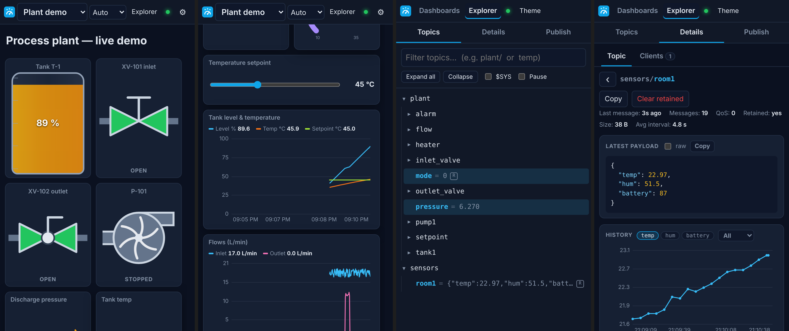

# Dashboards

## Editing

1. Click **Edit**. The widget palette and the topic list appear on the left, and the properties panel on the right.
2. **Add a widget:** drag it from the palette onto the canvas, or double-click it.
3. **Bind data:** drag a topic from the topic list onto a widget.
   - On a **trend**, this adds another line.
   - Dropping a topic on empty canvas creates a value display for it.
   - You can also type or drop a topic into the *State topic* field.
4. **Move and resize:** drag a widget to move it, and drag the blue corner to resize. Shift-click selects several widgets, which you can then align.
5. Changes save automatically. Click **Done** to return to the operator view.

| Key | Action |
|---|---|
| Del / Backspace | Delete selected |
| Ctrl+D | Duplicate |
| Arrows (Shift = ×5) | Nudge |
| Ctrl+Z / Ctrl+Y | Undo / redo |
| Ctrl+A | Select all |
| Esc | Deselect |

**Layering:** *To front* and *To back* in the properties panel. Put pipes and background images at the back.

**Sharing:** **Export** downloads a dashboard as JSON, and **Import** loads one.

## Widgets

| Group | Widget | Notes |
|---|---|---|
| Display | Value | Large number with units. Turns orange/red at warn/alarm thresholds. |
| | Gauge | Arc gauge with warn/alarm bands |
| | Bar | Horizontal or vertical |
| | Trend | Several lines on one chart. Loads recent history from the broker. |
| | Indicator | Lamp. Can blink when on (good for alarms). |
| | Multi-state | Maps values to text and colour, e.g. `0=Stopped:#64748b`, `1=Running:#22c55e` |
| | Message log | Scrolling log for a topic filter (wildcards allowed) |
| Process | Tank | Fill level with thresholds |
| | Valve | Gate, control, ball or plain symbol. Click to open/close (with confirmation). Shows a % position for numeric values. |
| | Pump / Fan | Pump, fan, motor or blower. Spins when running and blinks on fault. Click to start/stop. |
| | Pipe | 11 shapes (straight, elbows, tees, cross). Flow animates when a topic is "on". |
| Control | Switch | On/off toggle |
| | Button | Sends a fixed payload |
| | Slider | Sends a number |
| | Text input | Sends whatever you type |
| Layout | Text | Static text, or live text with a `{value}` template |
| | Image | Picture or schematic background |

### State topic vs command topic

Controls (switch, slider, valve, pump) show their state from the **state topic** and send commands to the **command topic**. If the command topic is blank, they send to the state topic.

Typical device pattern:

| | Topic | Payload |
|---|---|---|
| Device reports state | `home/pump/state` | `ON` / `OFF` |
| Dashboard sends command | `home/pump/set` | `ON` / `OFF` |

### JSON payloads

If a device sends JSON such as `{"temp": 21.5, "hum": 44}`, set **JSON path** to `temp`. Nested paths and arrays work too: `data.values[0]`.

### What counts as "on"?

Unless you set a specific ON value, these count as on: `1`, `true`, `on`, `open`, `running`, `start`, `yes`, `active`, `high` (any case), or any number greater than 0.

## Phones and tablets

The **Layout** menu in the top bar controls how a dashboard is shown:

| Layout | What it does |
|---|---|
| **Auto** (default) | Phones get *List*. Tablets and small windows get *Fit* when the dashboard is wider than the screen. |
| **List** | Touch-friendly cards: two across for small widgets, full width for charts, sliders and logs. Pipes, images and empty background panels are hidden. |
| **Fit to width** | Scales the whole canvas down so P&ID-style diagrams keep their layout. Pinch to zoom on phones. |
| **Actual size** | No scaling |

In the editor, every widget has a **Phone (list) view** section:
- **Hide in list view:** for decoration that only makes sense on the full diagram
- **List order:** lower numbers come first. If blank, the widget follows its position on the canvas, top to bottom.

Editing is hidden on phones. Edit on a computer and the phone view follows.
