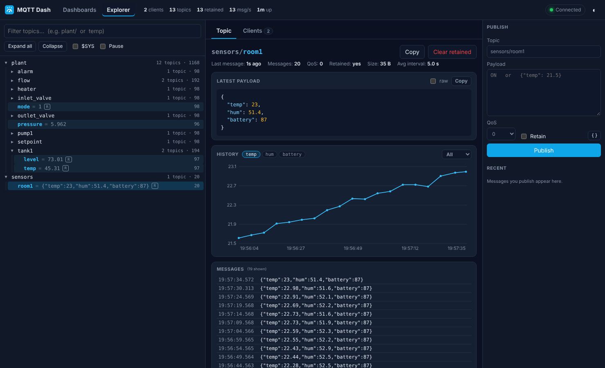

# Explorer

Open **http://&lt;host&gt;:8080/explorer**, or click **Explorer** in the top bar.

## Topic tree (left)

- Every topic seen by the broker, as a live tree. Rows flash when a new message arrives.
- Leaf topics show their latest value. **R** marks topics that have a retained message.
- Folders show how many topics are under them and how many messages they've had.
- **Filter:** type part of a topic, e.g. `plant/` or `temp`. Matching folders open automatically.
- **$SYS:** shows the broker's own statistics topics.
- **Pause:** stops the tree moving while you read it. Messages are still collected.

## Topic details (middle)

- **Latest payload:** JSON is formatted and colour-coded. Tick **raw** to see it exactly as sent.
- **Info:** time since the last message, message count, QoS, retained status, size, and the average time between messages.
- **History chart:** plots numeric payloads. For JSON, click the field chips (`temp`, `hum`, …) to choose what to plot. Hover to read values. Pick the time window from the dropdown.
- **Messages:** the latest 200, newest first, with ▲/▼ changes for numbers. Click one to expand it.
- **Copy:** copies the topic or the payload.
- **Clear retained:** removes the retained message by publishing an empty retained message.

You can link directly to a topic: `/explorer#t=plant/tank1/level`

## Publish (right)

Enter a topic and payload, choose QoS 0 or 1, and optionally tick **Retain**. The `{ }` button tidies up JSON. Your last 12 publishes are listed underneath; click one to load it again.

## Clients tab

Shows who's connected: client ID, username, TCP or WebSocket, address, how long they've been connected, messages sent, and their subscriptions. It refreshes every 5 seconds.

## On a phone

The Explorer shows one pane at a time, with **Topics / Details / Publish** tabs. Tap a topic to open its details, and tap **‹** to go back.
