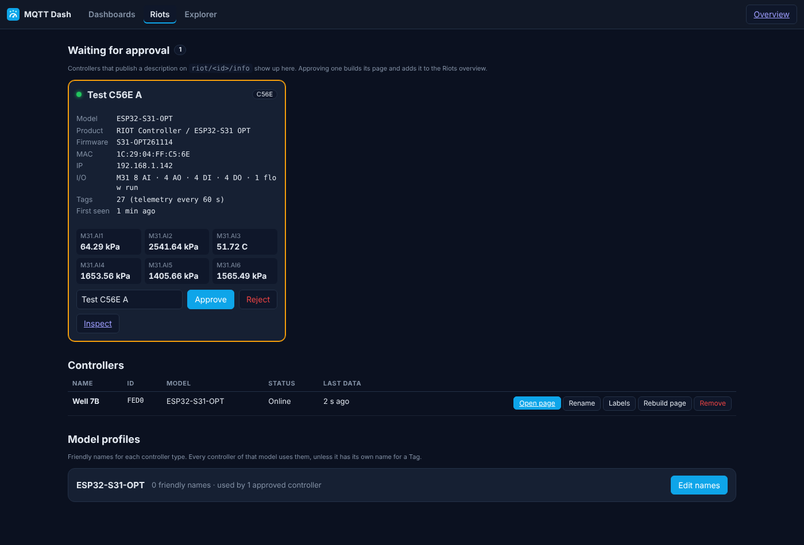
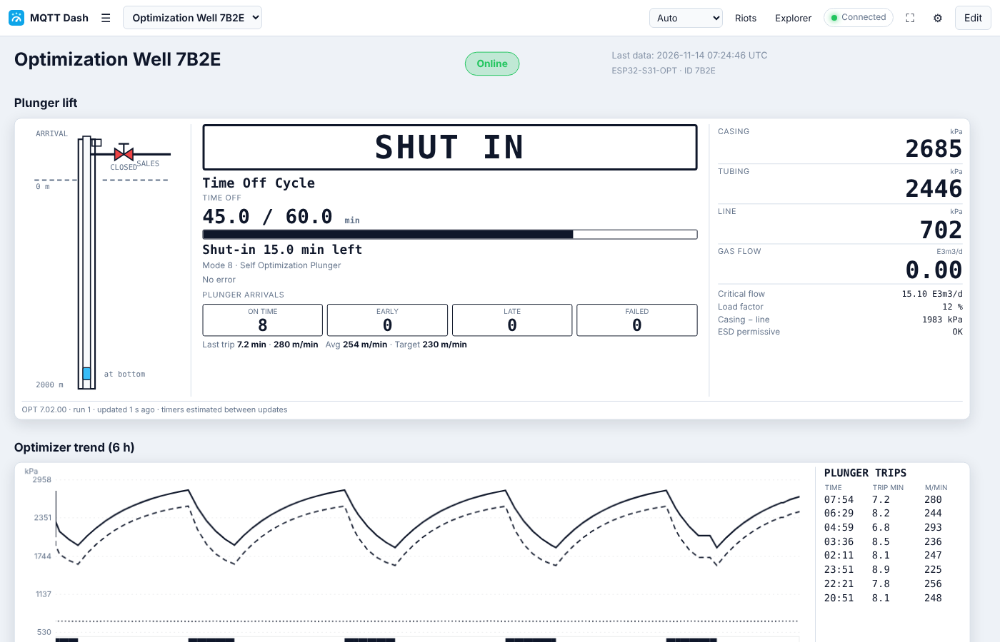
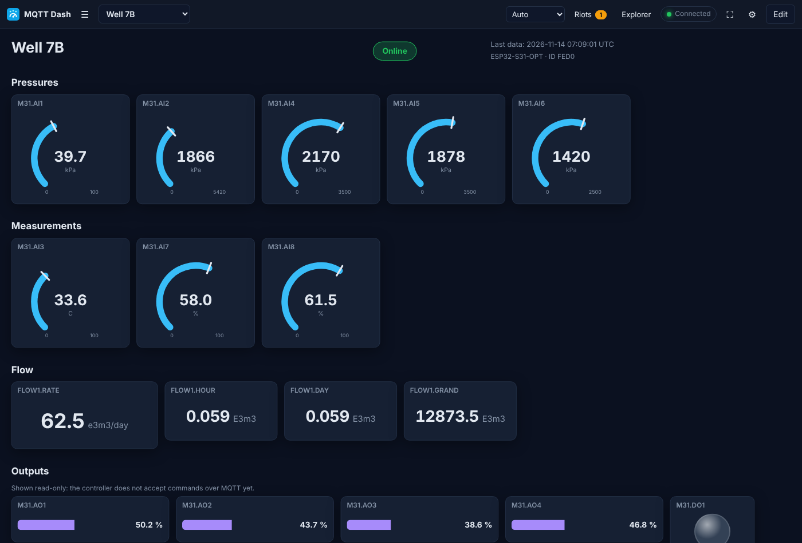

# RIOT controllers

riotdash recognises RIOT controllers (e.g. the ESP32-S31-OPT Optimization Well) on its own. A new controller waits for your approval. Once approved, it gets an automatically built page and a tile on the **Riots** overview.



## Approving a controller

1. Power up the controller with its MQTT base topic set to **`riot/<last four of its MAC>`**, e.g. `riot/FED0`, pointing at riotdash.
2. Open **Riots** in the top bar. A number on it means something is waiting.
3. Under **Waiting for approval** you'll see its model, firmware, MAC, IP, I/O and a live preview of its first values. Give it a name and press **Approve**.
4. riotdash builds its page (under the dashboard list as *riot-fed0*) and adds a tile to the **Riots** overview (`/#/d/riots`).

**Reject** ignores a controller's data (you can still approve it later). **Remove** deletes it and its page. If it's still connected it comes back as *waiting for approval*.

If two controllers report the same ID (two MACs ending in the same four characters), the card shows a warning with both client IDs.

## Friendly names

Tags arrive under their fixed default names (`M31.AI1`, `FLOW1.RATE`…), the same on every controller of a model. Friendly names are kept in riotdash:

- **Model profile** (Riots → *Model profiles* → **Edit names**): name a Tag once, e.g. `M31.AI2` → *Tubing pressure*, and every controller of that model uses it.
- **Per controller** (Riots → controller → **Labels**): an override for one controller only, e.g. a well where AI6 is wired differently.

When you save, tick **Rebuild the page(s) now** to apply the names. Rebuilding replaces manual edits on those pages, so either finish naming before you customise a page, or re-apply your tweaks afterwards.

The order is: per-controller name → model profile → the controller's own Tags-page label → the Tag name.

## Plunger lift (OPT 7.02 wells)



A well that sends optimizer data gets two panels at the top of its page, laid out like the controller's ePaper screen:

- **Plunger lift:**
  - the wellbore with the valve (green open, red closed) and the plunger's approximate place in the cycle. A real well has no position sensor, so it shows bottom, rising or at surface.
  - **FLOWING / SHUT IN** (or STOPPED / ESD), the cycle (e.g. *Post Plunger Sales Cycle*), and the timer against its setpoint with a progress bar and the time left
  - mode, error, plunger arrivals (on time, early, late, failed), the last trip, and average vs target velocity
  - casing, tubing, line and gas flow, plus critical flow, load factor, casing − line and ESD permissive

  Timers keep counting between messages, and the footer says when the last update arrived.
- **Optimizer trend:** casing (solid), tubing (dashed) and line (dotted) over 6 hours, with valve-open bars underneath, the last plunger trips (time, minutes, m/min) and *N cycles in 6 h · avg flow*.

On the **Riots** overview, the tile shows FLOWING / SHUT IN with gas flow and casing pressure.

This needs controller firmware that publishes `riot/<id>/opt7/1` (homershaw/Riot branch `feature/s31-opt-mqtt`). On the controller's MQTT page, tick **Send Optimizer data**, set the interval (1 min suggested) and **Also send on a state change**. If a well starts sending optimizer data after it was approved, its page is rebuilt once to add the panels.

## The generated well page



| Section | Contents |
|---|---|
| Header | Name, Online/Offline, time of the last data, model and ID |
| Pressures | Gauges for kPa / psi / bar inputs, scaled to each Tag's range |
| Measurements | Other analog inputs (°C, %) |
| Flow | Rate (large), hour, day and grand totals |
| Outputs | AO bars and DO lamps (**read-only** until the controller accepts commands, see below) |
| Discrete inputs | DI lamps |
| Calculated and manual values | e.g. TUBING_COPY, DOUBLE_TUBING, WELL_DEPTH |
| Trends | Pressures, and flow rate, over the last 6 hours |

Each page is an ordinary dashboard, so you can edit it like any other. On phones it uses the list layout automatically.

## Testing without hardware

```bash
node tools/riot-sim.js --id FED0 --name "Test well" --interval 10
```

This simulates an ESP32-S31-OPT using a real description (`tools/fixtures/riot-info-s31-opt.json`). Run several with different `--id`s.

## Message format (controller → riotdash)

All under the controller's base topic `riot/<id>` (`<id>`: 1–32 letters, digits, `_` or `-`; by convention the last four hex digits of the MAC).

| Topic | Retained | Payload |
|---|---|---|
| `info` | yes | Self-description (below). Sent on connect and when it changes. |
| `status/online` | yes | `true` / `false`. Set `false` as the MQTT last will. |
| `telemetry` | no | `{"type":"TELEMETRY","part":k,"parts":n,"tags":[{"name":"M31.AI1","value":52.3,"quality":"GOOD","eu":"kPa"},…]}`. Any number of Tags per part. |
| `opt7/<run>` | yes | OPT 7.02 status: the same JSON as the controller's `/api/optimization?run=n`, plus `run` and `epoch`. Sent every interval and on a cycle, valve, error or plunger-trip change. |
| `opt/meta/SPTn` | yes | `{"program":"5.00","points":{"SPTn.p":{"name":"…","units":"…","rw":1}}}` |
| `opt/SPTn` | no | `{"v":{"SPTn.p":value,…}}` |

`info` (schema 1) needs at least `"type":"INFO"`, `model` and `tags`. riotdash also uses `product`, `firmware`, `clientId` (the MAC is read from its last 12 hex digits, or from an explicit `"mac"`), `ip`, `site.name`, `site.location`, `telemetry.intervalSec`, `io` and, per Tag, `name`, `label`, `units`, `type` (`analog`/`digital`), `source`, `writable`, `telemetry` and `range`.

### What riotdash publishes from it

Decoded values are republished, retained, so widgets, trends and the Explorer can use them directly:

| Topic | Value |
|---|---|
| `riot/<id>/tag/<Tag name>` | the Tag's latest value |
| `riot/<id>/quality/<Tag name>` | its quality (`GOOD`, `BAD`, …), when it changes |
| `riot/<id>/opt/v/SPTn.p` | Optimizer soft-point values |
| `riot/<id>/meta/lastData` | time of the last telemetry |
| `riot/<id>/opt7/<run>/casing`, `tubing`, `line`, `flow`, `valve` | optimizer values (valve 1/0), kept with history for the trend |

## Writing from the dashboard (proposal, not yet implemented)

The controller currently subscribes to nothing, so outputs are shown read-only. A suggested command contract for the firmware:

| Direction | Topic | Payload |
|---|---|---|
| riotdash → controller | `riot/<id>/cmd` | `{"id":"<unique>","tag":"M31.DO1","value":1}` |
| controller → riotdash | `riot/<id>/cmd/ack` | `{"id":"<same>","ok":true}` or `{"id":"…","ok":false,"error":"not writable"}` |

The controller would accept only Tags it lists as `writable` and range-check them. The new value then shows up in the next telemetry. riotdash would then show sliders and switches (with confirmation) instead of read-only bars and lamps.
