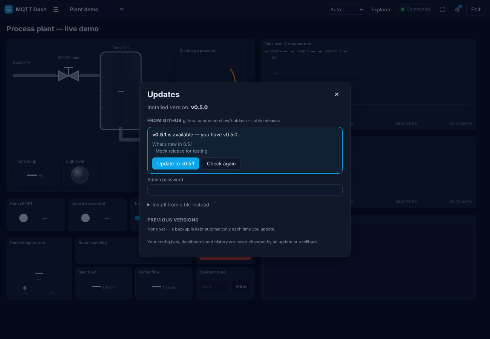

# Updating

## In the app (recommended)

1. Open the dashboard and go to **⚙ Settings → Updates…**. A blue dot on ⚙ means an update is waiting.
2. The dialog checks **github.com/homershaw/riotdash** and shows what's new.
3. Enter the **admin password** and click **Update to vX.Y.Z**.
4. A few seconds later the page reloads on the new version.



**No internet on the server?** Open **Install from a file instead** in the same dialog. Upload a `.tar.gz` downloaded from GitHub, e.g. `https://github.com/homershaw/riotdash/archive/refs/tags/v0.5.0.tar.gz`, or one built with `tools/release.sh`.

### Where updates come from

In `config.json`:

```json
"updates": { "github": "homershaw/riotdash", "channel": "main" }
```

| Channel | Gets |
|---|---|
| `main` (default) | The `main` branch, whenever its `package.json` version is higher than yours |
| `stable` | Only versions published as tags (`v0.5.1`, `v0.6.0`, …), e.g. GitHub Releases |

Set `"github": ""` to turn off checking GitHub.

### What the updater does

- **Checks the package first:** it must be riotdash / MQTT Dash, contain the server, and pass a syntax check. If anything fails, nothing is changed.
- **Never touches** `config.json` or the `data/` folder (dashboards, history, retained messages, admin password).
- **Backs up the version it replaces** in `.backups/`. The last 3 are kept.
- **Restarts itself.** `node server/index.js` runs a small supervisor that restarts the server after an update, whether you started it in a terminal or as a systemd service.

## Admin password

The first time you open **Updates…**, it asks you to create an admin password. For safety, you can only do this from a device on your local network, not through Cloudflare. On the server you can also run:

```bash
node server/index.js set-admin-password 'your-password'
```

That command also resets a forgotten password: delete `data/admin.json` first, then run it.

## Rolling back

**⚙ Settings → Updates… → Previous versions → Roll back.** Enter the admin password first. The version you roll back from is kept as a backup too.

## From the command line

```bash
node server/index.js update mqtt-dash-x.y.z.tar.gz
```

Then restart (Ctrl+C and start again, or `sudo systemctl restart mqtt-dash`).

Or, if you run it from a git clone:

```bash
git pull
# then restart
```

## Publishing a new version (maintainers)

With the default `main` channel, **merging to `main` is releasing**:

1. Make the changes on a branch and bump `version` in `package.json` (e.g. `0.5.1`).
2. Add a `## 0.5.1` section at the top of `CHANGELOG.md`. The app shows it as "What's new".
3. Open a pull request and merge it into `main`.

Every riotdash install then sees *v0.5.1 is available* in **Settings → Updates** (checks are cached for up to 30 minutes; **Check again** forces one).

If you'd rather test on `main` before installs pick it up, set `"channel": "stable"` and publish a **GitHub Release** with a tag such as `v0.5.1` when you're ready.

To build a package file for offline installs:

```bash
tools/release.sh            # → dist/mqtt-dash-<version>.tar.gz from the current commit
```

## Troubleshooting

| Message | Fix |
|---|---|
| *The server can't write to its app folder* | You installed as a service with an older installer. Run `sudo ./deploy/install.sh` once from the new version. |
| *Wrong admin password* | See [Admin password](#admin-password) to reset it. |
| *Package has no package.json* | That isn't a riotdash package. Use the `.tar.gz`, not a `.zip`. |
| *Couldn't check for updates / rate limit* | GitHub allows about 60 checks an hour without a login. The app caches checks for 30 minutes; wait and press **Check again**. |
| *Already up to date* | The version on GitHub isn't newer than what you run. |
| *Nothing has been published to the main branch yet* | Merge the pull request that adds the app to `main`. |
| Page doesn't come back after installing | Check the server log (`journalctl -u mqtt-dash -f` or the terminal), then roll back from the dialog or with the files in `.backups/`. |
